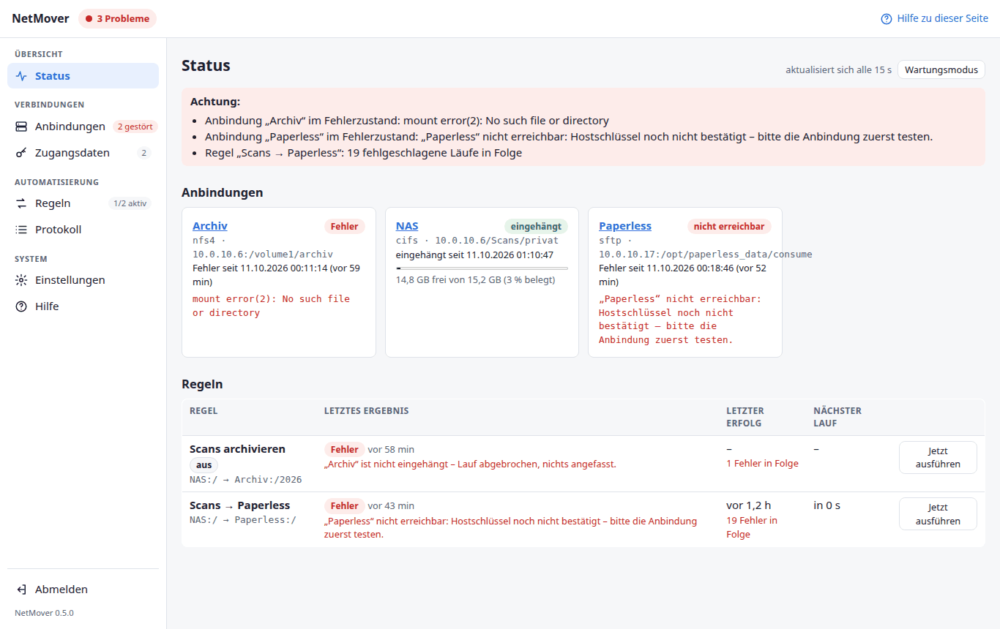
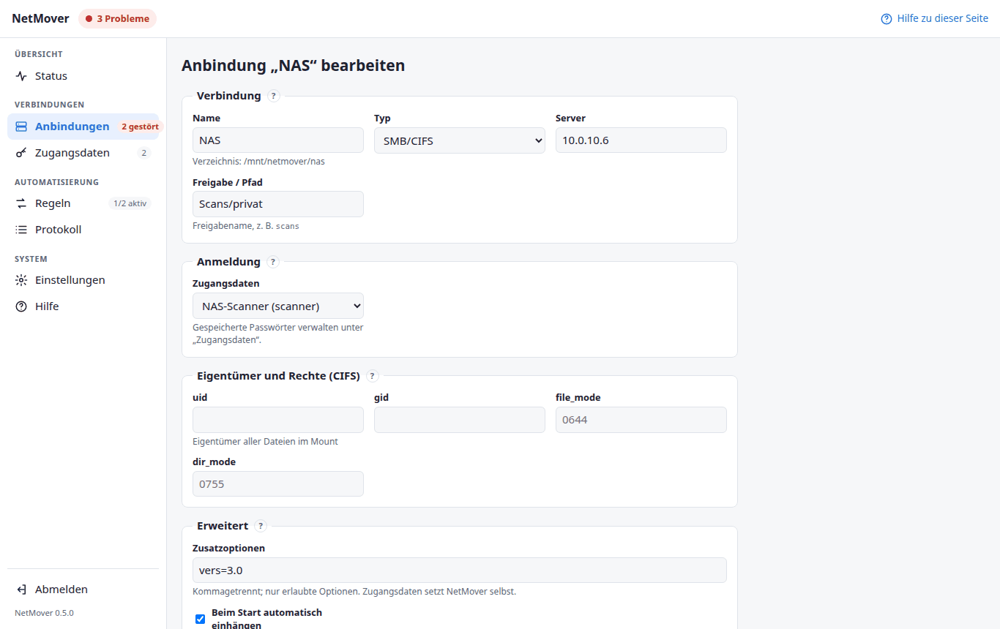
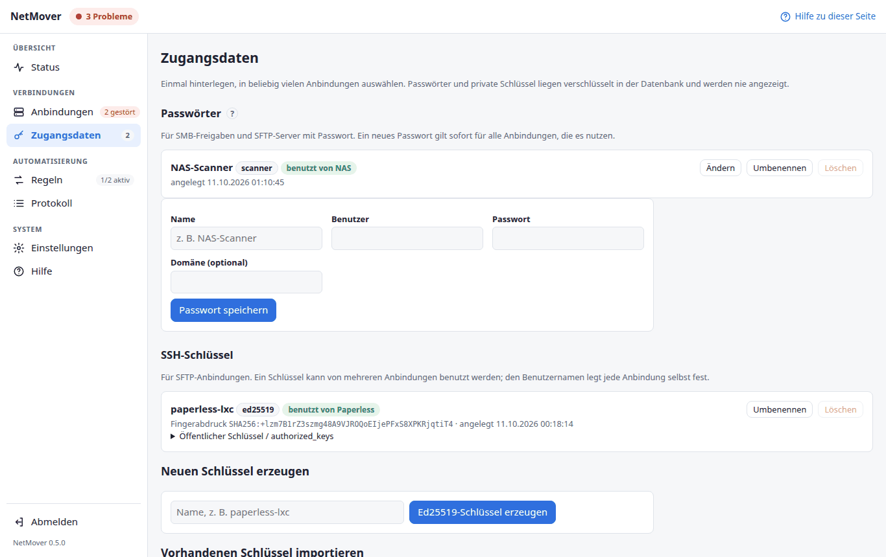
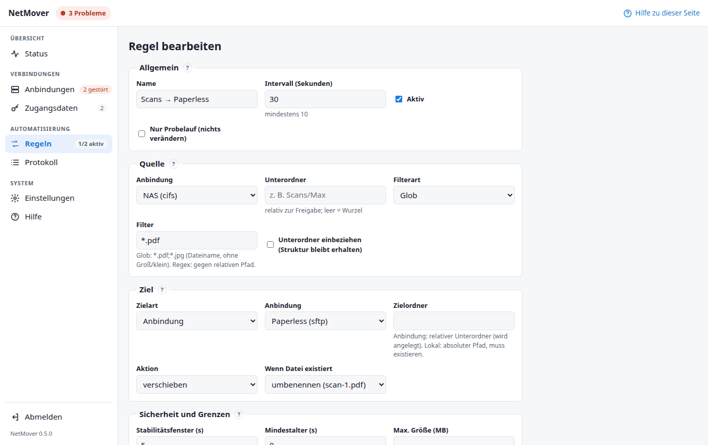

# NetMover – Anleitung {#anleitung}

NetMover holt Dateien regelmäßig aus einem Ordner und bringt sie sicher in einen
anderen. Typisch: Scans landen auf dem NAS, NetMover schiebt sie alle 30 Sekunden
in den Eingangsordner von Paperless.

Diese Anleitung erklärt die Bedienung. Installation, Updates und technische Details
stehen im [README](../README.md).

**Inhalt:** [Begriffe](#begriffe) · [Erste Anmeldung](#erste-anmeldung) ·
[Zugangsdaten](#zugangsdaten) · [Anbindungen](#anbindungen) · [Regeln](#regeln) ·
[Probelauf](#probelauf) · [Status](#status) · [Wartungsmodus](#wartungsmodus) · [Protokoll](#protokoll) ·
[Einstellungen](#einstellungen) · [Anmeldung](#anmeldung) · [Uptime Kuma](#uptime-kuma) · [Beispiele](#beispiele) · [Häufige Fragen](#fragen)

## Die vier Begriffe {#begriffe}

| Begriff | Was es ist | Beispiel |
|---|---|---|
| **Anbindung** | Ein Ort, an den NetMover herankommt: eine SMB-Freigabe, ein NFS-Export oder ein Server per SFTP | „NAS“ = `//10.0.10.6/Scans` |
| **Zugangsdaten** | Gespeicherter Benutzer mit Passwort oder SSH-Schlüssel, in mehreren Anbindungen nutzbar | „NAS-Scanner“, „paperless-lxc“ |
| **Regel** | „Alle N Sekunden aus Anbindung A nach Anbindung B“ – mit Filter, Sicherheitsprüfungen und Verhalten bei gleichen Namen | „Scans → Paperless“ |
| **Lauf** | Eine Ausführung einer Regel; steht mit allen Dateien im Protokoll | 23:41:07, 3 Dateien verschoben |

Die Reihenfolge beim Einrichten ist immer dieselbe – und so ist auch das Menü
aufgebaut: **(Zugangsdaten) → Anbindungen → Regeln → Status und Protokoll beobachten.**



## Erste Anmeldung {#erste-anmeldung}

Beim allerersten Aufruf verlangt NetMover ein Administratorpasswort (mindestens 10
Zeichen) und einen **Einrichtungscode**. Der Code steht im Log des Dienstes:

```bash
journalctl -u netmover | grep setup.required
```

Der Code verhindert, dass jemand anderes im Netz zuerst die Seite öffnet und das
Passwort festlegt. Passwort ändern: *System → Einstellungen*.

## Anbindungen {#anbindungen}

*Verbindungen → Anbindungen → Neue Anbindung*



### Typ wählen {#anbindung-typ}

| Typ | Wofür | Kann |
|---|---|---|
| **SMB/CIFS** | Windows-Freigaben, Synology, QNAP, … | Quelle und Ziel |
| **NFS 4 / NFS 3** | Linux-Server, NAS mit NFS | Quelle und Ziel |
| **SFTP** | Server, die nur per SSH erreichbar sind (z. B. ein LXC mit Paperless) | Quelle und Ziel |

SMB- und NFS-Anbindungen werden **eingehängt** und erscheinen unter
`/mnt/netmover/<name>`. SFTP wird nicht eingehängt, NetMover verbindet sich bei
jedem Lauf. Als **Quelle** gelten bei SFTP dieselben Sicherheitsprüfungen; weil
SFTP-Server Änderungszeiten nur sekundengenau melden, sollte das
Stabilitätsfenster dort mindestens 2 Sekunden betragen.

### Felder {#anbindung-felder}

| Feld | Bedeutung |
|---|---|
| **Name** | Frei wählbar. Bestimmt auch das Verzeichnis unter `/mnt/netmover` (wird beim Anlegen festgelegt). |
| **Server** | IP-Adresse oder Hostname, z. B. `10.0.10.6` |
| **Freigabe / Pfad** | SMB: Freigabename, optional mit Unterordner (`Scans` oder `Scans/privat`). NFS: Exportpfad (`/volume1/scans`). SFTP: absoluter Ordner auf dem Server (`/opt/paperless_data/consume`). |
| **Benutzername / Passwort** | Bei SMB leer lassen für Gastzugang. Beim Bearbeiten heißt ein leeres Passwortfeld „unverändert“ – Passwörter werden nie angezeigt. |
| **Zugangsdaten / Anmeldeart** | Gespeicherte Zugangsdaten auswählen oder eigene Angaben nur für diese Anbindung; bei SFTP zusätzlich SSH-Schlüssel oder Passwort, siehe [Zugangsdaten](#zugangsdaten). |
| **uid, gid, file_mode, dir_mode** (SMB) | Wem die Dateien im eingehängten Ordner gehören. Meist leer lassen. |
| **Zusatzoptionen** | Für Sonderfälle, z. B. `vers=3.0` oder `nohandlecache`. Nur erlaubte Optionen; Zugangsdaten setzt NetMover selbst. |
| **Beim Start automatisch einhängen** | Nach einem Neustart des Servers wieder einhängen. Fällt das NAS aus, versucht NetMover es außerdem jede Minute erneut. |
| **Aktiv** | Deaktivierte Anbindungen werden von Regeln nicht benutzt. |

### Testen {#anbindung-testen}

**Testen** prüft drei Dinge einzeln und sagt im Klartext, was nicht klappt:

1. **Einhängen** bzw. **Verbinden** (SFTP)
2. **Lesen** – Inhalt des Ordners auflisten
3. **Schreiben** – Testdatei anlegen, Eigentümer prüfen, wieder löschen

Daraus folgt, wofür die Anbindung taugt: **nur Quelle, kopieren** (nur lesen),
**Quelle mit Löschen** (lesen und löschen – nötig zum Verschieben) oder **Ziel**.
Man kann schon im Formular testen, bevor man speichert.

Bei SFTP hält der erste erfolgreiche Test den **Hostschlüssel** des Servers fest. Den
angezeigten Fingerabdruck einmal auf dem Server vergleichen:
`ssh-keygen -lf /etc/ssh/ssh_host_ed25519_key.pub`. Ändert er sich später,
verweigert NetMover die Verbindung (Schutz gegen untergeschobene Server). Wurde der
Server neu aufgesetzt: bei der Anbindung **Hostschlüssel zurücksetzen** und neu testen.

### Zustände {#anbindung-zustaende}

| Anzeige | Bedeutung |
|---|---|
| **eingehängt** / **erreichbar** | alles gut |
| **ausgehängt** / **nicht geprüft** | nicht in Benutzung |
| **gestört** | Antwortet nicht oder meldet „Stale file handle“; NetMover hängt gerade neu ein |
| **Fehler** | Wiederherstellung gescheitert; NetMover versucht es jede Minute weiter (bei „automatisch einhängen“) |

Regeln, deren Anbindung nicht verfügbar ist, **brechen ab, ohne etwas anzufassen**.
Es wird nie in ein leeres Verzeichnis geschrieben, nur weil die Freigabe fehlt.
Solche Regeln **warten** automatisch, bis die Anbindung zurück ist (siehe
[Status](#status)), und laufen dann von selbst weiter.

## Zugangsdaten {#zugangsdaten}

*Verbindungen → Zugangsdaten*

Benutzer und Passwörter für Freigaben sowie SSH-Schlüssel einmal hinterlegen und in
beliebig vielen Anbindungen auswählen. Passwörter und private Schlüssel liegen
verschlüsselt in der Datenbank und werden nie angezeigt.



### Passwörter {#zugangsdaten-passwoerter}

Für SMB-Freigaben und SFTP-Server mit Passwort: Name, Benutzer, Passwort und
optional Domäne. In der Anbindung unter *Zugangsdaten* auswählen statt „eigene
Angaben“. **Ändern** setzt Benutzer, Domäne oder ein neues Passwort – das gilt sofort
für alle Anbindungen, die den Eintrag nutzen (praktisch, wenn das NAS-Passwort
wechselt).

### SSH-Schlüssel {#schluessel}

Für SFTP ist ein Schlüssel sicherer als ein Passwort. Einen Schlüssel kann man für
mehrere Anbindungen verwenden; den Benutzernamen legt jede Anbindung fest.

**Neuen Schlüssel erzeugen** – Namen eingeben, *Ed25519-Schlüssel erzeugen*. Dann:

1. Bei dem Schlüssel *Öffentlicher Schlüssel / authorized_keys* aufklappen und die
   **authorized_keys-Zeile** kopieren. Sie beginnt mit
   `restrict,command="/usr/lib/openssh/sftp-server"` – damit darf der Schlüssel
   **nur SFTP**, keine Shell.
2. Auf dem Server an die Datei `~/.ssh/authorized_keys` des Benutzers anhängen
   (Ordner `~/.ssh` mit Rechten `700`, Datei `600`, Eigentümer der Benutzer).
3. In der Anbindung *Anmeldeart: SSH-Schlüssel* und den Schlüssel wählen, **Testen**.

**Vorhandenen Schlüssel importieren** – privaten Schlüssel einfügen (OpenSSH- oder
PEM-Format; Ed25519, ECDSA oder RSA ab 2048 Bit). Hat er eine Passphrase, diese
angeben: Sie wird nur zum Entschlüsseln benutzt.

Gespeicherte Zugangsdaten lassen sich nur löschen, wenn sie keine Anbindung mehr nutzt.

## Regeln {#regeln}

*Automatisierung → Regeln → Neue Regel*



### Quelle und Ziel {#regel-quelle-ziel}

| Feld | Bedeutung |
|---|---|
| **Quelle: Anbindung, Unterordner** | Woher. Unterordner relativ zur Freigabe; leer = Wurzel der Freigabe. |
| **Filter** | Glob: Dateiname, Groß/klein egal, mehrere mit `;` (`*.pdf;*.jpg`). Regulärer Ausdruck: gegen den relativen Pfad (`^rechnungen/.*\.pdf$`). |
| **Unterordner einbeziehen** | Auch in Unterordnern suchen; die Ordnerstruktur bleibt im Ziel erhalten. |
| **Ziel** | Eine Anbindung mit Zielordner (wird angelegt) oder ein **lokaler Pfad** auf dem NetMover-Server (muss existieren). |
| **Aktion** | **verschieben** (Quelle wird nach erfolgreicher Übertragung gelöscht) oder **kopieren** (Quelle bleibt; jede Dateiversion wird nur einmal kopiert). |
| **Wenn Datei existiert** | **umbenennen** (`scan.pdf` → `scan-1.pdf`, `scan-2.pdf` …), **überspringen** oder **überschreiben**. |

### Sicherheit und Grenzen {#regel-sicherheit}

| Feld | Bedeutung | Empfehlung |
|---|---|---|
| **Intervall** | Wie oft geprüft wird (mind. 10 s) | 30 s |
| **Stabilitätsfenster** | Größe **und** Änderungszeit müssen so lange gleich bleiben. Schützt vor halb geschriebenen Scans. | 5 s, bei langsamen Scannern mehr |
| **Mindestalter** | Dateien erst ab diesem Alter anfassen | 0 |
| **Max. Größe** | Größere Dateien überspringen | leer |
| **Zeitlimit ohne Fortschritt** | Bricht einen Lauf ab, der hängt (z. B. NFS-Server weg). Große Dateien, die stetig übertragen werden, sind nicht betroffen. | 120 s |

Immer ignoriert werden versteckte Dateien (`.datei`), unfertige Übertragungen
(`.part`, `.tmp`, `.crdownload`, `.filepart`, `.!ut`), Verknüpfungen und
Synology-Verwaltungsordner (`@eaDir`, `#recycle`).

### Rechte und Quarantäne {#regel-rechte}

| Feld | Bedeutung |
|---|---|
| **Eigentümer setzen** | `uid:gid`, z. B. `1000:1000`. Auf SMB-Zielen wirkungslos (dort bestimmen die Mount-Optionen den Eigentümer), auf NFS nur ohne Root-Squash. |
| **Modus setzen** | z. B. `0644`; leer = wie die Quelldatei |
| **Quarantäneordner** | Dateien, die mehrmals hintereinander scheitern, werden dorthin verschoben (relativ zur Quell-Anbindung), statt es endlos zu versuchen. Leer = keine Quarantäne. |

### Probelauf {#probelauf}

**Probelauf** zeigt in einer Tabelle, welche Datei wohin ginge – **ohne etwas zu
verändern**. Vor dem ersten Aktivieren einer Regel immer einmal machen.

Das Häkchen **Nur Probelauf** in der Regel lässt sie regelmäßig laufen, ohne etwas zu
verändern – gut zum Beobachten über ein paar Tage.

### Wie verschoben wird {#wie-verschoben-wird}

Für jede Datei:

1. zweimal messen (Abstand = Stabilitätsfenster) – nur unveränderte Dateien weiter,
2. freien Platz am Ziel prüfen (Größe + 5 %),
3. unter einem versteckten Namen `.netmover-….part` ins Ziel schreiben und auf die
   Platte zwingen,
4. prüfen, dass sich die Quelle in der Zwischenzeit nicht verändert hat,
5. in einem Schritt auf den Endnamen umbenennen – ohne etwas zu überschreiben,
6. **erst dann** die Quelle löschen.

Geht unterwegs etwas schief, bleibt die Quelle liegen und im Ziel steht nichts
Halbes. Ein Programm, das den Zielordner überwacht (Paperless), sieht nie eine
unfertige Datei.

## Status {#status}

*Übersicht → Status* ist die Startseite und aktualisiert sich alle 15 Sekunden.

- **Ampel** oben links: grün = alles in Ordnung, rot = mindestens ein Problem.
- **Anbindungen** mit Zustand, Füllstand und letztem Fehler.
- **Regeln** mit letztem Ergebnis, **letztem Erfolg** und nächstem Lauf.

Eine Regel wird **gelb**, wenn ihr letzter erfolgreicher Lauf länger als das
Dreifache ihres Intervalls zurückliegt. So fällt auf, wenn NetMover still ausfällt
– statt dass es aussieht, als gäbe es nichts zu tun.

### Regel wartet auf eine Anbindung {#wartet}

Ist die Quelle oder das Ziel einer Regel nicht erreichbar (NAS neu gestartet, Server
aus), **pausiert die Regel automatisch**: Sie zeigt „wartet seit …“ mit dem Grund.

- Im Protokoll steht **ein** Eintrag „Pausiert, bis die Anbindung zurück ist“ – nicht
  alle 30 Sekunden ein neuer Fehler.
- Es kommt **eine** Benachrichtigung pro Anbindung, mit der Liste der betroffenen
  Regeln.
- Sobald die Anbindung zurück ist, **läuft die Regel von selbst weiter**; der nächste
  Lauf vermerkt „Fortgesetzt nach … Wartezeit“, und es kommt eine Entwarnung.

Man muss also nach einem NAS-Neustart nichts tun.

### Wartungsmodus {#wartungsmodus}

Der Knopf **Wartungsmodus** auf der Statusseite pausiert **alle geplanten Läufe** –
etwa während eines NAS-Updates. Oben erscheint dann gelb „Wartungsmodus“. „Jetzt
ausführen“ geht weiterhin. Für Regeln meldet `/healthz` in dieser Zeit keinen Alarm
(Anbindungen werden weiter geprüft). Mit **Wartungsmodus beenden** läuft alles
wieder nach Plan.

## Protokoll {#protokoll}

*Automatisierung → Protokoll* zeigt jeden Lauf: Zeitpunkt, Dauer, gesehen /
übertragen / übersprungen / Fehler. *Einzeldateien* aufklappen zeigt jede Datei mit
Ziel und Ergebnis. Leere Läufe sind ausgeblendet („auch leere Läufe“ zeigt sie).

Häufige Einträge:

| Eintrag | Bedeutung |
|---|---|
| *wird noch geschrieben* | Datei ändert sich noch – im nächsten Lauf erneut |
| *Datei ist gerade in Benutzung* | Ein anderes Programm hält sie gesperrt |
| *existiert bereits im Ziel* | Regel steht auf „überspringen“ |
| *Quelle hat sich während der Übertragung geändert* | Abgebrochen, nichts gelöscht; nächster Lauf versucht es erneut |
| *n bereits übertragen* | Kopiermodus: diese Dateiversionen sind schon kopiert |
| *Termin übersprungen – voriger Lauf läuft noch* | Ein Lauf dauert länger als das Intervall |
| *Pausiert, bis die Anbindung zurück ist* | Quelle oder Ziel nicht erreichbar; die Regel wartet, siehe [Regel wartet](#wartet) |
| *Fortgesetzt nach … Wartezeit* | Die Anbindung ist zurück, die Regel läuft wieder |

Protokolle werden nach der eingestellten Frist gelöscht (Standard 30 Tage).

## Einstellungen {#einstellungen}

*System → Einstellungen*

### Benachrichtigungen {#benachrichtigungen}

NetMover meldet Probleme per **E-Mail** und/oder an einen **Webhook** (z. B. ntfy,
Gotify, Home Assistant). Beides lässt sich gleichzeitig nutzen.

| Feld | Bedeutung |
|---|---|
| **Benachrichtigen** | nie / bei jedem fehlgeschlagenen Lauf / erst nach N Fehlschlägen in Folge. Fällt eine **Anbindung** aus, kommt die Meldung immer sofort (einmal, mit den betroffenen Regeln). |
| **Entwarnung** | Nachricht, wenn eine Regel oder Anbindung wieder funktioniert |

**E-Mail:**

| Feld | Bedeutung |
|---|---|
| **SMTP-Server, Port, Verschlüsselung** | z. B. `smtp.example.org`, `587` mit STARTTLS oder `465` mit SSL/TLS. „keine“ nur für interne Relays. Zertifikate werden immer geprüft. |
| **Benutzer, Passwort** | Anmeldung am SMTP-Server; leer = ohne Anmeldung. Das Passwort wird verschlüsselt gespeichert und nie angezeigt. |
| **Absender, Empfänger** | Empfänger mit Komma getrennt |

*Test-E-Mail senden* prüft die gespeicherten Einstellungen und zeigt bei Fehlern die
Antwort des Servers.

**Webhook:**

| Feld | Bedeutung |
|---|---|
| **Webhook-URL** | Adresse des Empfängers. Wird nur gekürzt angezeigt, weil sie oft ein Token enthält. |
| **Content-Type, Vorlage** | Format der Nachricht; Platzhalter `$title`, `$message`, `$rule`, `$event`, `$time`, `$host` |

Beispiele: ntfy → URL `https://ntfy.sh/<thema>`, Content-Type `text/plain`, Vorlage
`$title: $message`. Gotify → URL `https://gotify.lan/message?token=…`, Content-Type
`application/json`, Vorlage `{"title": "$title", "message": "$message"}`.
*Test senden* prüft die gespeicherten Einstellungen.

### Überwachung mit Uptime Kuma {#uptime-kuma}

Zwei Wege, die sich gut ergänzen:

**1. Push (empfohlen)** – NetMover meldet sich jede Minute bei Kuma.

1. In Kuma *Neuer Monitor → Typ „Push“*, Heartbeat-Intervall 60 s. Kuma zeigt eine
   Push-URL wie `https://kuma.lan/api/push/AbCdEf?status=up&msg=OK&ping=`.
2. In NetMover *System → Einstellungen → Überwachung* die URL eintragen, speichern,
   *Push jetzt testen*.

NetMover meldet „up“ oder „down“ samt Problembeschreibung. Bleibt die Meldung ganz
aus – Dienst oder VM steht –, schlägt Kuma von selbst Alarm. Funktioniert auch, wenn
Kuma NetMover nicht erreichen kann.

**2. HTTP-Monitor** – Kuma fragt NetMover ab. Antwort **200** = in Ordnung,
**503** = Problem; ohne Anmeldung erreichbar.

| Adresse | Prüft |
|---|---|
| `http://<netmover>:8080/healthz` | alles: Scheduler, alle aktiven Anbindungen und Regeln |
| `http://<netmover>:8080/healthz/mount/<name>` | eine Anbindung (Name wie im Verzeichnis unter `/mnt/netmover`, z. B. `nas`) |
| `http://<netmover>:8080/healthz/rule/<nummer>` | eine Regel |

Die fertigen Adressen stehen unter *Einstellungen → Überwachung → Adressen für
HTTP-Monitore*. Mit einem Monitor pro Anbindung und Regel sieht man in Kuma sofort,
*was* gestört ist. `/healthz` liefert außerdem JSON mit allen Einzelprüfungen
(Kuma-Typ „HTTP(s) – JSON-Abfrage“, Ausdruck `status`, erwarteter Wert `ok`).

Als Problem gilt: Scheduler steht, eine aktive Anbindung ist im Fehlerzustand, eine
aktive Regel hatte länger als das Dreifache ihres Intervalls keinen Erfolg oder ist
dreimal hintereinander gescheitert.

### Anmeldung {#anmeldung}

Standardmäßig fragt NetMover immer nach dem Passwort. Unter *Einstellungen →
Anmeldung* lässt sich das ändern (Bestätigung mit dem aktuellen Passwort):

| Einstellung | Wirkung |
|---|---|
| **immer** (empfohlen) | Anmeldung bei jedem Zugriff |
| **nicht aus vertrauenswürdigen Netzen** | ohne Passwort aus den eingetragenen Netzen, z. B. `10.0.10.0/24`; von überall sonst mit Passwort |
| **nie** | keine Anmeldung – nur hinter einem Reverse Proxy mit eigener Anmeldung (z. B. Authelia, Authentik) |

Solange ohne Anmeldung gearbeitet wird, steht oben gelb „ohne Anmeldung“. Der Schutz
gegen untergeschobene Formulare bleibt immer aktiv.

> NetMover läuft als root und kennt die Zugangsdaten deiner Freigaben. Wer die
> Oberfläche ohne Anmeldung erreicht, kann alles ändern. Läuft ein Reverse Proxy auf
> demselben Server, kommen alle Anfragen von `127.0.0.1` – dann `127.0.0.1` nicht als
> vertrauenswürdig eintragen und `NETMOVER_FORWARDED_ALLOW_IPS` setzen.

Zurück zur Anmeldung: dieselbe Einstellung auf „immer“, oder auf dem Server
`/opt/netmover/venv/bin/netmover reset-password` (setzt auch die Anmeldung zurück).

### Export und Import {#export-import}

*Konfiguration exportieren* lädt Anbindungen, Regeln und Einstellungen als JSON
herunter – **ohne** Passwörter, Schlüssel, Benutzernamen und Webhook-URL. Beim
Import werden vorhandene Namen übersprungen; importierte Regeln sind zunächst
deaktiviert, Zugangsdaten müssen neu eingegeben werden.

## Typische Einrichtungen {#beispiele}

### Scanner → NAS → Paperless {#beispiel-paperless}

1. Anbindung **NAS** (SMB, Freigabe `Scans`), testen, einhängen.
2. Unter *Zugangsdaten* den Schlüssel **paperless-lxc** erzeugen, Zeile in
   `authorized_keys` im Paperless-LXC eintragen.
3. Anbindung **Paperless** (SFTP, Pfad `/opt/paperless_data/consume`, Schlüssel
   wählen, Benutzer = der Paperless-Benutzer), testen.
4. Regel **Scans → Paperless**: Quelle NAS, Filter `*.pdf`, Ziel Paperless,
   verschieben, umbenennen, 30 s. **Probelauf**, dann aktivieren.

### Jede Person in einen eigenen Ordner {#beispiel-unterordner}

Scannt jede Person in einen eigenen Unterordner (`Scans/max`, `Scans/erika`): pro
Person eine Regel mit eigenem **Unterordner** in der Quelle und eigenem Ziel.

### Kopie als zusätzliche Sicherung {#beispiel-kopie}

Regel mit Aktion **kopieren**, Ziel z. B. ein zweites NAS, Intervall 3600 s. Jede
Dateiversion wird genau einmal kopiert; ändert sich eine Datei, wird die neue Version
nach der Kollisionsregel abgelegt.

## Häufige Fragen {#fragen}

**Eine Datei wird nicht verschoben.** – Im Protokoll der Regel (auch leere Läufe
anzeigen) steht der Grund. Häufig: Filter passt nicht (Groß/klein ist bei Glob egal,
bei regulären Ausdrücken nicht), Datei wird noch geschrieben oder ist größer als
„Max. Größe“.

**Die Anbindung zeigt „Fehler“.** – Die Meldung darunter nennt die Ursache und meist
die Abhilfe. Ist das NAS nur neu gestartet, hängt NetMover die Freigabe innerhalb
einer Minute selbst wieder ein; die Regeln warten so lange und laufen dann weiter.

**Ich mache gleich ein NAS-Update.** – Vorher auf der Statusseite *Wartungsmodus*
einschalten, danach wieder beenden. Nötig ist es nicht (die Regeln warten ohnehin
von selbst), aber so gibt es keine Alarme.

**„mount error(95): Operation not supported“** – NAS und NetMover finden keine
gemeinsame SMB-Version. Am NAS das maximale SMB-Protokoll auf SMB3 stellen
(Synology: Systemsteuerung → Dateidienste → SMB → Erweiterte Einstellungen) oder
Zusatzoption `vers=2.0`.

**„Root-Squash“ beim Testen einer NFS-Anbindung** – Der NFS-Server behandelt
NetMover wie einen Gast. Lesen und Schreiben gehen oft trotzdem, aber „Eigentümer
setzen“ nicht. Abhilfe am NAS in der NFS-Regel: *Squash → Keine Zuordnung*.

**Kann NetMover Dateien verlieren?** – Die Quelle wird erst gelöscht, wenn die Datei
vollständig und unter ihrem Endnamen im Ziel liegt. Fehlt eine Anbindung, wird nichts
angefasst. Einzig „überschreiben“ als Kollisionsregel ersetzt bewusst Dateien im Ziel.

**Wie aktualisiere ich NetMover?** – Auf dem Server `netmover-update`. Vorher wird
automatisch gesichert. Details im README.

**Passwort vergessen?** – Auf dem Server `/opt/netmover/venv/bin/netmover
reset-password`, Dienst neu starten, Einrichtung mit neuem Code aus dem Log.
